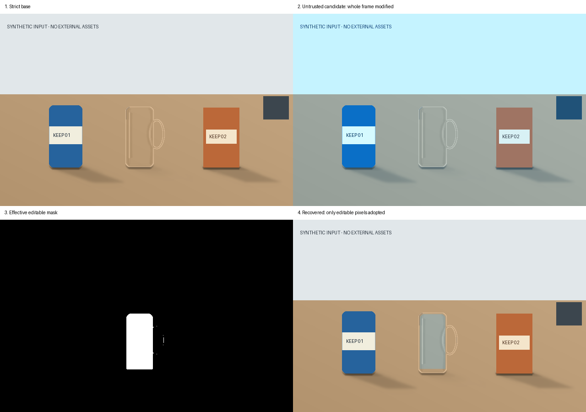
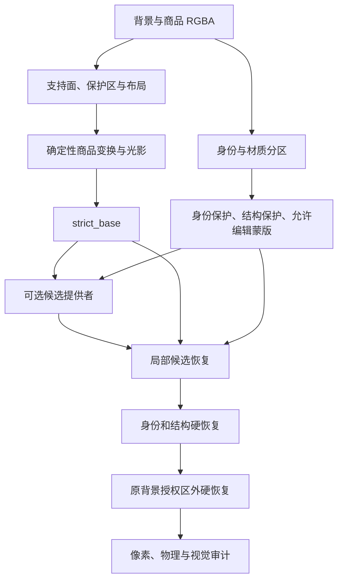

# IdentityGuard

Identity-preserving Product Compositing and Regional Re-rendering

**面向商品图像合成的身份保护与材质分区局部重渲染研究原型。**

这个项目研究一个具体问题：将商品放入新场景时，怎样利用生成候选改善透明材质的外观，同时保留文字、Logo、标签、轮廓和未授权背景。

本地程序先完成确定性合成，再根据身份、结构和材质建立编辑蒙版。外部模型只提供候选或受限效果；最终采用哪些像素，由本地恢复与审计决定。

> **运行要求：CPython 3.13。** 部分渲染源码曾在历史开发中截断，目前由随仓库保留的 `_render_runtime.cpython-313.pyc` 提供。`render.py` 是可读入口与接触轮廓修补层。其他主要模块为可读 Python 源码。此仓库不是完整可审阅的纯源码渲染器，也未验证其他 Python 小版本。

## 离线演示

下图全部由程序生成。右上候选故意改变整个画面；右下结果只接收左下授权区内的候选像素。



演示用于验证编辑范围和像素恢复，不用于证明摄影真实感或正式视觉验收。

```powershell
git clone https://github.com/CHINAITENGINEER/identity-guard-rerender.git
cd identity-guard-rerender
py -3.13 -m venv .venv
.\.venv\Scripts\Activate.ps1
python -m pip install -r requirements-core.txt -c constraints-tested.txt
python tools/run_synthetic_demo.py --out output/synthetic
```

如果终端没有 `py` 启动器，使用已安装的 CPython 3.13 的 `python` 命令创建环境。
这个示例不需要 API 密钥、模型权重或网络请求；依赖安装需要包下载。

示例生成三件几何商品、背景、两份 Job、严格图层、局部候选、蒙版和 `pixel_contract.json`。直接检查：

```text
identity_changed_pixels = 0
outside_changed_pixels = 0
max_outside_delta = 0
background_pixel_audit.verdict = pass
```

本次 640×420 演示开放 7,050 个像素，实际采用候选的 7,050 个像素全部位于允许区内。输入、候选、参数与生成器均可重放，详见 [examples/README.md](examples/README.md)。

## 方法



记严格底图为 `S`、候选为 `C`、允许区为 `A`、身份与结构保护区为 `G`：

```text
R = A AND NOT G
d = distanceTransform(R)
t = clip(d / adaptive_feather_width, 0, 1)
w = t² × (3 − 2t)
F = round((1 − w) × S + w × C)

F[NOT R] = S[NOT R]
F[G] = S[G]
F[NOT authorized_mask] = original_background[NOT authorized_mask]
```

距离场融合用于控制接缝，最后的硬恢复保证编辑边界。清玻璃路线还包含有限的稀疏高频光学补偿。

严格路线保留原商品的确定性像素来源；混合路线允许授权透明区域采用候选 RGB。混合路线保护的是身份、结构和未授权区域，不能表述成“商品每一个像素都来自原图”。

完整推导见 [算法说明](docs/ALGORITHMS.md)，论文与工程取舍见 [研究来源](docs/RESEARCH.md)。

## 已有模块

| 模块 | 内容 |
|---|---|
| 抠图与完整度 | Alpha 质量检查、多候选选择、框提示分割适配、原 RGB 保留 |
| 场景与几何 | 支持面、保护区、相对深度/法线证据、RANSAC 平面候选 |
| 自动布局 | 单应变换、接触约束、碰撞检查、相对尺度、间距和背景可读性代价 |
| 确定性光影 | 接触 AO、方向投影、半影与屏幕空间倒影 |
| 透明材质 | 目标背景采样、透射与折射代理、有限环境反射与界面高光 |
| 身份保护 | 身份蒙版同变换、轮廓与孔洞保护、材质路由和局部候选恢复 |
| 受限学习效果 | 张量类型/形状/范围验证、阴影包络、整场两阶段提交与回退 |
| 审计 | 背景零差异、身份与越界变化统计、物理证据和内容哈希绑定 |
| 使用入口 | CLI、本地 FastAPI 工作台、文件夹批处理与可选浏览器回归 |

几何与光学包含二维启发式和单视图代理，未完成真实三维材质恢复或完整物理光线追踪。项目未训练新的扩散模型、OCR 模型或重光照网络。

## 安装与运行

依赖按用途拆分，避免离线示例强制下载深度学习框架：

| 文件 | 用途 |
|---|---|
| `requirements-core.txt` | 本地合成、候选恢复和离线演示 |
| `requirements.txt` | 加入本地 FastAPI 工作台 |
| `requirements-models.txt` | 可选自动抠图与场景模型适配 |
| `requirements-dev.txt` | 自动测试 |
| `requirements-browser.txt` | 可选真实浏览器回归 |

本地工作台：

```powershell
python -m pip install -r requirements.txt -c constraints-tested.txt
python -m strict_compositor.ui
```

浏览器入口为 `http://127.0.0.1:8765`。自动抠图和深度/语义分析需要对应可选模型及权重。工作台面向可信本地单用户环境，未完成公网服务的鉴权、并发与隔离设计。

重放 CLI：

```powershell
python -m strict_compositor.cli compose --job output/synthetic/strict_job.json --out output/cli_strict
python -m strict_compositor.cli compose --job output/synthetic/hybrid_job.json --out output/cli_hybrid
```

`Job` 中的相对文件路径以 Job JSON 所在目录解析。普通 `compose` 成功仍会输出 `pending_visual_review`、`batch_unlock=false`。正式质量验证要求有效且绑定当前图片的 `final_gate.json`，不接受手填分数。

文件夹批处理：

```powershell
python tools/batch_auto_compose.py --mode structured --input path/to/groups --dry-run
python tools/batch_auto_compose.py --mode random --input path/to/product_background_folders --seed 42 --dry-run
```

结构化模式取每组前 3 张商品和第 4 张背景；随机模式读取 `products/` 与 `backgrounds/`（也兼容中文目录名）。完整运行要求先启动并配置工作台。默认批处理跳过末端多轮视觉评分，需要 `--strict-audit` 才请求严格末端审计。

## 可选云端能力

- MiniMax 适配：场景、材质、布局建议与视觉评审；模型名和服务地址可配置。
- RunningHub 抠图：仅采用有效 Alpha，商品 RGB 重新取自原图。
- RunningHub Hybrid：独立候选工作流，结果必须经过本地蒙版恢复。
- Learned Shadow V1：独立受限阴影图契约，模型不能自行扩大几何授权包络。

公开版不预填账号工作流 ID，也不附带密钥、可运行云工作流、权重或私人图片。使用者需自行配置并验证外部服务。Windows 的界面密钥存储使用当前用户 DPAPI；`ui_workspace/` 和 `.env` 均被忽略。

## 验证与当前边界

```powershell
python -m pip install -r requirements-dev.txt -c constraints-tested.txt
python -m pytest -q
```

公开测试包含 `unittest` 与 pytest 函数，统一用 pytest 收集。Node.js 用于内嵌前端 JavaScript 语法检查。私人 holdout 图片未分发，对应一项测试会跳过。

本次整理已验证：CPython 3.13 下 **396 项测试通过、1 项跳过，另有 33 个子测试通过**；离线示例与 CLI 重放的背景像素审计通过。具体环境与结果记录在 [验证记录](docs/VALIDATION.md)。GitHub Actions 配置在 Windows、Python 3.13 下执行相同公开测试与离线示例。

像素不越界、图层生成成功与视觉自然度是独立指标。`hybrid_render.status=applied` 不代表视觉通过；90 分是交付门禁规则，不是本仓库已达到的成绩。公开演示没有对照片真实性或多场景通过率做结论。

## 仓库导航

```text
strict_compositor/       核心算法、适配器、CLI 和工作台
tests/                  公开的几何、像素、合同和回退测试
tools/                  离线示例、批处理与辅助工具
examples/               可复现示例说明
docs/ALGORITHMS.md      算法与公式
docs/RESEARCH.md        论文来源与转译边界
docs/VALIDATION.md      本次发布验证
docs/RUNTIME.md         冻结运行时来源与限制
docs/THIRD_PARTY.md     第三方依赖、模型及素材说明
```

更细的历史设计可参见 [身份保护设计](docs/HYBRID_IDENTITY_RENDERING.md)、[受限效果契约](docs/LEARNED_EFFECTS_ARCHITECTURE.md) 和 [抠图流程](docs/CUTOUT_PIPELINE_V3_13.md)。这些文档保留部分早期设计，应以当前源码与本次验证记录为准。

## 许可证状态

本仓库尚未单独指定代码开源许可证。第三方依赖、模型权重和数据集分别遵循各自条款；论文引用不构成对研究代码或权重的再授权。本仓库的演示素材由脚本生成，不包含私人商品照片、聊天记录或原始数据集。
