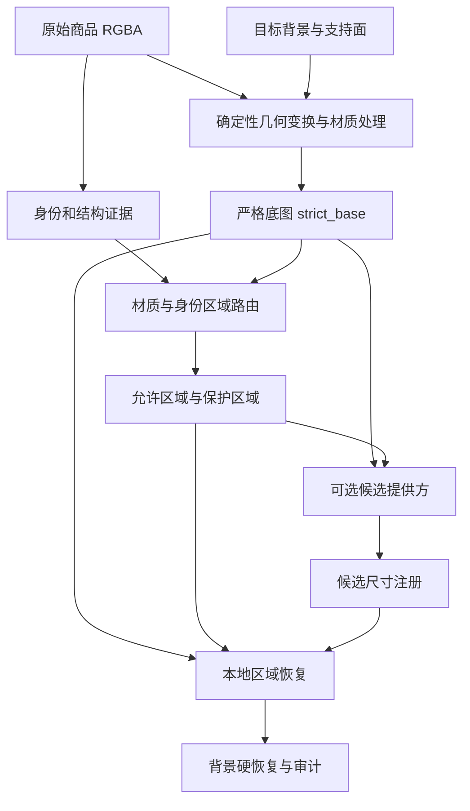

# 身份保护与局部重渲染算法

本项目研究商品置入真实场景时的两个要求：商品文字、图案和结构需要保留，透明材质又需要随目标环境改变。实现先产生确定性合成底图，再根据身份信息和材质建立可编辑区域，仅在该区域接收候选像素，最后检查保护区和区域外像素是否变化。

这里的“局部重渲染”指候选结果的受限恢复流程。它可以接收外部模型产生的候选，但本仓库没有训练新的扩散模型。论文背景见 [研究来源](RESEARCH.md)，使用入口见 [README](../README.md)。

## 1. 数据流与两种合成路线



严格路线从输入 RGBA 出发执行确定性的几何、颜色和材质处理。混合路线在此基础上，允许获准的透明内部采用外部候选 RGB；身份和结构区域仍从严格底图恢复。因此，混合路线的保真基准是变换和处理后的 `strict_base`，不能把它解释成所有商品像素均与未经缩放的源照片相同。

商品布局、数量、尺度和前后层级由本地流程确定。候选图不拥有这些决策。相关入口包括 [pipeline.py](../strict_compositor/pipeline.py)、[identity.py](../strict_compositor/identity.py) 和 [hybrid.py](../strict_compositor/hybrid.py)。

## 2. 身份、结构和光学区域

在最终画布上，定义以下布尔蒙版：

| 符号 | 代码含义 | 示例 |
|---|---|---|
| `I` | 身份硬恢复区 | 文字、Logo、标签、图案 |
| `Sg` | 结构保护带 | 轮廓、把手孔、细杆、杯口、底座 |
| `A` | 允许重渲染区 | 获准的透明材质内部 |
| `G = I ∪ Sg` | 全局保护区 | 任一商品声明必须保留的像素 |
| `R = A ∩ ¬G` | 最终有效编辑区 | 可以实际采用候选的像素 |

身份蒙版使用与商品相同的单应变换进入最终画布。当前实现用最近邻重采样，再做一像素保守膨胀，并与放置后的 Alpha 相交，以保护文字的抗锯齿过渡。源身份蒙版必须与源 RGBA 尺寸对应。

结构保护通过 Alpha 的腐蚀差分获得：

```text
occupied = alpha > threshold
interior = erode(occupied, kernel)
structure_guard = occupied AND NOT interior
```

这种表达同时覆盖外轮廓和内部孔洞周围的边缘，避免模型把壶把孔填实。保护带宽度与商品尺寸有关；底座等结构还可使用额外的保守保护。

材质路由使用显式身份蒙版、身份状态、商品语义和材质信息。无字透明器皿可以开放内部；带包装文字的不透明商品倾向整件保留；混合透明商品需要对标签和透明体进行分区。代码中的自动判断含有启发式规则，不能等同于完整 OCR、Logo 或标签检测系统。已知有身份内容却缺少可信位置证据时，应采用严格路线。

## 3. 候选尺寸注册的能力边界

`load_registered_candidate()` 接受两种情况：

1. 候选与底图尺寸完全一致，直接进入恢复。
2. 尺寸不同但宽高比相对误差不超过 `0.008`，以 Lanczos 缩放到目标尺寸。

超过阈值的候选会被拒绝。这里的 `pixel_registered` 是当前代码对同尺寸候选的状态命名，不代表算法已经验证了商品内容逐像素对齐。

当前注册没有特征点匹配、光流或非刚性配准。模型移动商品、改变视角、局部变形或生成错误透明结构时，仅靠画幅相同比例不能解决问题，仍需独立视觉检查。

## 4. 距离场与自适应 smoothstep 融合

设严格底图为 `B`，注册后的候选为 `C`，有效区域为 `R`。若 `R` 为空，函数返回严格底图副本和 `strict_fallback` 状态。

对于非空区域：

```text
d = distanceTransform(R)
r = percentile(d[d > 0], 99)
t = clip(d / feather_width, 0, 1)
w = t² × (3 − 2t)
F = round(B × (1 − w) + C × w)
```

`d` 描述像素离区域边界的距离，`r` 近似描述可编辑内部的尺度。smoothstep 在过渡两端具有零导数，用于缓解底图与候选交界处的明显接缝。

当前恢复器使用两类过渡配置：

| 配置 | 羽化宽度依据 | 目的 |
|---|---|---|
| 一般身份保护 | `max(feather_pixels, 0.18 × r)`，通常上限 18 px | 抑制候选注册后的边缘光晕 |
| 清玻璃光学界面 | `clip(max(3, 0.055 × r), 3, 8)` | 保留口沿、把手和厚底附近的窄高光 |

第二类只有存在足够的 `optical_polish` 授权区域时启用。上述数字是当前工程实现的参数，不是普适物理常数。固定 18 px 过渡可能在高分辨率玻璃上抹掉窄结构；过窄的过渡又可能留下候选光晕，需要在固定输入下比较。

该恢复器直接对加载的 RGB 数组做数值插值；它与其他模块中的线性光学计算是不同路径。不能据此声称整个项目所有混合操作都已统一为物理线性光。

## 5. 稀疏光学残差恢复

外部候选在缩放或去噪后，可能保留大尺度透射，却丢失少量使玻璃可辨认的界面高光。当前恢复器在 `optical_polish ∩ R` 内比较底图与融合图的亮度高频分量：

```text
Y = 0.2126 R + 0.7152 G + 0.0722 B
high = Y − Gaussian(Y)
missing = positive_part(high_base − high_blended − threshold)
```

实际代码用百分位阈值提取稀疏正向信号，限制补偿幅度，并按内部融合权重衰减。当前总补偿上限为 14 个编码通道数值，随后再次执行硬恢复。

它恢复的是已有确定性底图和候选中的有限光学细节，不能恢复已经彻底丢失的文字，也不保证得到真实物理反射。幅度限制、稀疏阈值和区域限制共同防止大范围泛白与跨区修改。

## 6. 硬恢复与像素不变量

软融合之后执行：

```text
F[NOT R] = B[NOT R]
F[G]     = B[G]
```

流水线再恢复原背景授权区 `U` 之外的像素：

```text
F[NOT U] = original_background[NOT U]
```

软融合负责接缝，最后的赋值负责保护边界。即使提供方返回一张整体被重画的候选，候选也只能通过本地允许区进入最终图。

恢复器计算以下指标：

```text
identity_changed_pixels == 0
outside_changed_pixels  == 0
max_outside_delta       == 0
```

前三项相对于 `strict_base` 检查混合恢复；背景审计另以原始背景为基准检查授权区外零变化。两种基准不能混用。

候选尺寸、蒙版形状或硬恢复不变量检查失败时，流水线应回退严格结果。`applied` 仅表示候选按恢复合同应用，不等于视觉验收通过。

## 7. 低频协调与透明光学近似

### 低频协调

[harmonization.py](../strict_compositor/harmonization.py) 使用 Alpha 归一化低通，减少透明区隐藏底色对前景的污染：

```text
L = Gaussian(RGB × alpha) / max(Gaussian(alpha), epsilon)
H = RGB − L
RGB_new = L_new + H
```

这样可以有限调整大尺度光色，同时保留较多原图细节。高频不完全等于身份，低频也不完全等于光照，仍需身份保护和结果检查。

### 透明光学

[optical_matte.py](../strict_compositor/optical_matte.py) 将透明外观拆为覆盖率、透射颜色、二维折射位移和反射／高光代理。教学上可近似写为：

```text
glass_rgb ≈ target_background(p + refraction_flow) × transmission × (1 − Fresnel)
            + target_environment_reflection × Fresnel
            + bounded_interface_highlight
```

这些计算在相关光学分支的线性光空间中进行，再按覆盖率与目标场景合成。目标背景参与像素形成，能够避免简单复制透明源图时连带复制旧房间。

当前表示属于单视图屏幕空间近似，没有恢复完整三维厚度、真实折射率、BRDF 或全局光照。复杂反射、强遮挡、镜面和拍摄视角不匹配仍可能失败。几何覆盖率与光学透射率应分别理解。

## 8. Hybrid 与 Learned Effects 的区别

| 机制 | 接收内容 | 本地限制 | 当前用途 |
|---|---|---|---|
| Hybrid candidate | RGB 候选图 | `allow − guard`、尺寸检查、硬恢复 | 授权透明内部的外观恢复 |
| Learned Effects 合同 | 阴影 Alpha、有限低频增益、有限高光残差 | 形状、类型、范围、身份区及支持面检查 | 可替换的局部效果实验接口 |
| RunningHub Shadow V1 | 单张场景级灰度阴影图 | 本地几何包络、接触连续性、强度上限 | 受限在线阴影适配路径 |

Learned Effects 位于接收面效果写入最终图之前，Hybrid 位于严格预合成之后。二者的位置、数据合同和像素权限不同，不能把 RGB 候选塞入阴影或增益字段。

场景级效果先验证所有商品，再一次性提交。任一商品、候选或报告构造失败时整体回退，避免出现一部分商品已改、另一部分仍用旧效果的状态。接口、模拟测试或适配代码存在，不代表真实服务已配置、网络已训练或视觉效果已经通过。

## 9. 验证范围与尚未解决的问题

可直接验证的目标包括：保护区和授权区外像素不变，蒙版随商品变换保持一致，非法候选拒绝，以及失败后的严格回退。参见 [身份与恢复测试](../tests/test_identity_hybrid.py)、[候选提供方测试](../tests/test_hybrid_runninghub.py) 和 [背景审计](../strict_compositor/validate.py)。

像素不变量不能证明候选自然、文字在缩小后可读、接地正确或跨场景泛化。几何、物理证据和人眼效果仍需分别检查。固定案例的多次迭代也不能算成多个独立测试场景。

当前部分确定性渲染实现通过 CPython 3.13 冻结运行时保留；具体安装和可维护性边界以 README 为准。上述方法说明与源码可见范围应分别看待。
