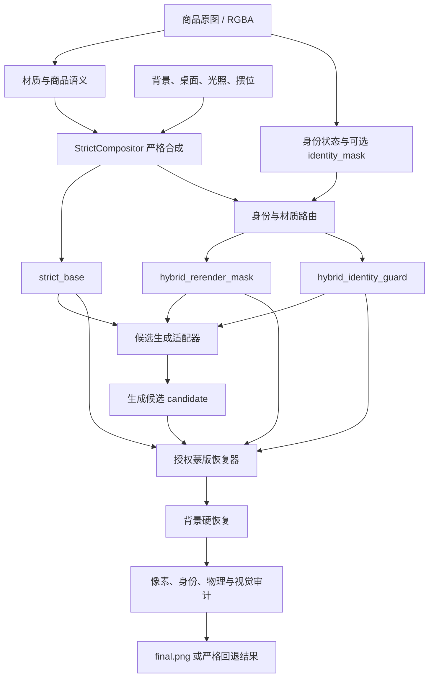

# 文字与 Logo 硬保护的混合重渲染架构

## 1. 文档目的

本文定义商品场景合成中的混合重渲染链路：生成模型可以改善透明材质的透射、折射、高光与环境融合，但不能取得商品身份像素和最终画面的所有权。

核心原则是：

> 严格合成结果是唯一权威底图；生成结果只是一个光学候选。最终图只在预先授权的无身份区域采用候选像素，文字、Logo、标签、轮廓、结构边缘和候选区外像素全部从严格底图硬恢复。

这套设计首先解决当前三类商品的实际差异：

- 无字透明玻璃壶：允许模型改善透明内部的光学表现；
- 带字易拉罐：整件保持严格合成，不让模型重写品牌和小字；
- 带标签酒瓶：V1 整件保持严格合成；未来有可靠 OCR/Logo 区域蒙版后，只开放标签之外的玻璃区域。

本文同时说明当前 V1 实现、失败回退、审计证据、前端使用方式，以及未来局部 OCR 区域重渲染的演进路径。

## 2. 不可破坏的系统不变量

混合重渲染不是“让提示词要求模型别改字”，而是由本地像素恢复强制保证以下不变量：

1. `strict_base` 是最终恢复基准。任何保护像素都从它复制，而不是让模型重新生成。
2. 文字、Logo、标签和其他显式身份区在最终图中必须与 `strict_base` 逐像素一致。
3. 商品外轮廓、把手孔洞、杯口、底座、细杆和 Alpha 内孔边缘必须保留严格合成结构。
4. `hybrid_rerender_mask` 之外的最终像素必须与 `strict_base` 逐像素一致。
5. 原始背景授权区之外的最终像素仍必须与原背景逐像素一致。
6. 候选生成、下载、尺寸注册、蒙版或恢复任一环节失败时，最终输出必须回退为完整的 `strict_base`。
7. 未知身份状态不能等同于“确认没有文字”。只有非常有限的透明无字语义快捷路线可以在 V1 使用该假设，并且必须写入审计来源。
8. 混合功能默认关闭；关闭时不得改变现有严格合成的输出和审计行为。
9. 生成候选不参与摆位、尺寸、相机透视、商品数量或 z-order 决策。
10. V1 不通过反复生成和评分挑选最佳图，避免算力失控和刷分式候选搜索。

## 3. 总体架构



职责边界如下：

| 组件 | 拥有的决策 | 不拥有的决策 |
|---|---|---|
| 严格合成器 | 商品位置、Alpha、轮廓、阴影、倒影、背景授权区、权威底图 | 生成式透明光学细节 |
| 身份路由器 | 哪些商品/区域必须硬保护，哪些透明内部可开放 | 不生成任何 RGB 像素 |
| 候选适配器 | 请求一次候选图，并记录服务来源 | 不决定最终可采用哪些像素 |
| 恢复器 | 在本地按授权蒙版混合并硬恢复 | 不依赖提示词判断文字是否安全 |
| 审计器 | 证明候选区外和身份区没有变化 | 不以主观分数替代像素不变量 |

## 4. 数据契约

### 4.1 商品身份字段

每个 `ProductSpec` 支持以下字段：

| 字段 | 可选值 / 类型 | 含义 |
|---|---|---|
| `identity_status` | `unknown`、`confirmed_absent`、`detected`、`unavailable`、`failed` | 身份分析状态；默认 `unknown` |
| `identity_mask` | 路径或 `null` | 与源 RGBA 同尺寸的单通道身份蒙版 |
| `rerender_policy` | `auto`、`never`、`transparent_optical`、`regional` | 商品级重渲染策略；默认 `auto` |
| `semantic_category` | 字符串 | 例如 `glass_pitcher`、`aluminum_beverage_can` |
| `physical_type` | 字符串 | 例如 `rigid_vessel` |
| `material_mode` | 现有材质枚举 | 决定是否属于可开放的透射材质 |

`identity_mask` 使用源 RGBA 坐标，而不是背景坐标。流水线使用商品完全相同的 homography 将其放到最终画布：

- 采用最近邻采样，避免细字笔画被插值抹掉；
- 放置后进行一像素保守膨胀，覆盖 Lanczos 商品变换产生的抗锯齿边界；
- 最后与已放置商品 Alpha 相交，身份区不能泄漏到商品外部。

如果身份蒙版尺寸与源 RGBA 不一致，任务必须拒绝该蒙版，不能静默缩放一个可能已经过期的身份证据。

### 4.2 混合任务字段

任务级 `hybrid_render` 契约为：

```json
{
  "enabled": true,
  "provider": "manual_candidate",
  "candidate": "path/to/candidate.png",
  "prompt": "Re-render only the supplied editable transparent-product regions..."
}
```

字段含义：

| 字段 | 含义 |
|---|---|
| `enabled` | 是否请求混合候选；默认 `false` |
| `provider` | `manual_candidate` 或 `runninghub` |
| `candidate` | 手动候选路径；存在时优先按手动候选处理 |
| `prompt` | 传给支持提示词节点的提供商；最多 4000 字符，不承担安全职责 |

密钥不进入 `job.json`、审计 JSON 或图片元数据。RunningHub 使用现有 DPAPI 加密的密钥，任务 JSON 只保存非敏感路由配置。

## 5. 身份与材质路由

### 5.1 三类蒙版

`build_identity_masks()` 为每件已放置商品生成：

- `hard_restore_mask`：必须从 `strict_base` 硬恢复的商品身份区；
- `structure_guard_mask`：外轮廓和 Alpha 内孔周围的结构保护带；
- `rerender_allow_mask`：允许候选像素进入最终图的区域。

结构保护带通过商品 Alpha 的腐蚀差分得到，能同时保护：

- 商品外轮廓；
- 壶把、杯把和孔洞边缘；
- 细杆、瓶颈、杯口等窄结构；
- 底座与透明体外缘。

全局恢复时，所有商品的身份保护区和结构保护区取并集。只要任一商品把某像素声明为保护区，候选就不能覆盖它。

### 5.2 V1 的保守路由

V1 的默认规则如下：

| 条件 | 路由 | 原因 |
|---|---|---|
| `rerender_policy=never` | `strict_product` | 明确禁止生成像素 |
| `identity_status=detected` 且没有可靠区域蒙版 | `strict_product` | 知道有身份内容，但不知道其精确位置 |
| `identity_status=unavailable/failed` | `strict_product` | 检测不可用时 fail closed |
| 语义包含 bottle、can、package、label、printed 等 | `strict_product` | 包装/标签身份概率高 |
| 非透射材质且无明确区域策略 | `strict_product` | V1 不需要重绘不透明商品 |
| `clear_glass` + `confirmed_absent` | `regional_rerender` | 已确认无文字透明玻璃，只开放内部 |
| `clear_glass` + `unknown` + 明确无标签透明器皿语义 | `regional_rerender` | V1 的受限语义快捷路线 |
| `transparent_optical` 且为透明玻璃、没有已知身份 | `regional_rerender` | 显式开放透明光学内部 |
| `regional` + 非空显式身份蒙版 + 透射材质 | `regional_rerender` | 高级区域路线 |

`regional` 是高级策略，必须满足以下安全前置条件：

- 如果 `identity_status=detected`，必须提供非空、与源 RGBA 对齐的 `identity_mask`；
- 如果只知道“有文字”但没有定位结果，必须退回 `strict_product`；
- 空蒙版不能被解释为“检测完成且确认无文字”，除非状态明确为 `confirmed_absent`。

### 5.3 V1 的实际三商品路线

| 商品 | 当前建议 | 最终效果 |
|---|---|---|
| 透明玻璃壶 | `auto`，`clear_glass`，`glass_pitcher` | 只开放壶体内部；轮廓、杯口、把手孔和底座仍硬保护 |
| 易拉罐 | `auto`，语义含 `can` | 整件严格；候选只能影响其他获准商品 |
| 带标签酒瓶 | `auto`，语义含 `bottle` | V1 整件严格；未来有 OCR/标签蒙版后再局部开放玻璃 |

这里的“透明区域重渲染”不等于删除透明物体的结构。开放区已经扣除了身份保护与结构保护，只允许模型补充目标环境相关的透射、折射和高光变化。

## 6. 候选生成适配器

### 6.1 统一接口

所有提供商必须实现：

```python
class HybridCandidateProvider(Protocol):
    def render(self, request: HybridRenderRequest) -> HybridRenderResult: ...
```

`HybridRenderRequest` 包含：

| 字段 | 内容 |
|---|---|
| `strict_base` | 完整严格预合成 PNG |
| `edit_mask` | `hybrid_rerender_mask.png` |
| `protect_mask` | `hybrid_identity_guard.png` |
| `prompt` | 光学编辑说明 |
| `expected_size` | 最终目标宽高 |
| `output_dir` | 本次运行目录 |

`HybridRenderResult` 返回：

- `candidate_path`：候选图片路径；
- `provider`：提供商名称；
- `task_id`：可选的外部任务号；
- `provenance`：非敏感工作流来源信息。

提供商可以忽略蒙版、误改文字甚至重画整张图；这些行为不会直接进入最终图，因为本地恢复器仍是最终像素所有者。

### 6.2 手动候选

`manual_candidate` 用于将 GPT、MiniMax Hub 或其他工具生成的完整候选图送入本地恢复链。它适合：

- 快速验证生成质量；
- 对比不同生成模型；
- 在尚未部署自动工作流时进行人工实验。

手动候选不是最终图。即使候选中的易拉罐小字或酒瓶标签已经变形，最终恢复仍会拒绝这些像素。

### 6.3 RunningHub 候选

RunningHub 混合重渲染使用独立工作流，不能复用抠图 App/工作流。独立设置包括：

- `runninghub_hybrid_enabled`
- `runninghub_hybrid_mode`
- `runninghub_hybrid_app_id`
- `runninghub_hybrid_source_node_id` / `source_field_name`
- `runninghub_hybrid_mask_node_id` / `mask_field_name`
- `runninghub_hybrid_protect_node_id` / `protect_field_name`（可选）
- `runninghub_hybrid_prompt_node_id` / `prompt_field_name`
- `runninghub_hybrid_output_node_id`

适配器上传严格底图和允许重渲染蒙版；若配置了保护节点，也会上传身份/轮廓保护蒙版。随后按配置创建一次 AI App 或 ComfyUI 任务，下载指定输出节点的图片，并把任务号和节点来源写进审计。

抠图工作流继续遵守“只取 Alpha、丢弃云端 RGB”；混合重渲染工作流则允许返回 RGB 候选，但该 RGB 仍只能经过本地授权恢复后使用。两者的安全语义完全不同，因此配置必须分离。

### 6.4 候选尺寸注册

候选加载遵循以下规则：

1. 宽高完全一致：标记为 `pixel_registered`，直接进入恢复；
2. 尺寸不同但宽高比相对误差不超过 `0.8%`：使用确定性的 Lanczos 缩放到目标尺寸，标记为 `aspect_compatible_resize`；
3. 宽高比误差超过阈值：拒绝候选并严格回退。

该规则可以接纳“同画幅但输出尺寸不同”的 GPT/MiniMax 候选，同时拒绝裁切、补边或构图明显改变的图片。V1 只做全画幅尺度注册，不做特征点、光流或局部几何配准；如果模型移动了商品，视觉验收仍应拒绝该候选。

## 7. 授权蒙版恢复算法

设：

- `S` 为严格底图 `strict_base`；
- `C` 为注册后的生成候选；
- `A` 为全局 `rerender_allow_mask`；
- `G` 为 `hard_restore_mask ∪ structure_guard_mask`；
- `R = A ∩ ¬G` 为最终有效重渲染区。

V1 在 `R` 内做一个向内渐入的软融合：

```text
d = distanceTransform(R)
w = clip(d / 5px, 0, 1)
F_soft = round(S × (1 - w) + C × w)
```

随后必须执行两次硬恢复：

```text
F[¬R] = S[¬R]
F[G]  = S[G]
```

最后继续执行原有背景恢复：

```text
F[¬authorized_mask] = original_background[¬authorized_mask]
```

软融合只用于避免授权区边缘出现接缝；硬恢复才是身份安全边界。提示词、候选蒙版响应和模型自律都不能替代最后两次赋值。

V1 的候选授权区位于已放置商品 Alpha 内部，属于原有 `authorized_mask` 的子集。候选不能自行扩大阴影、倒影或背景编辑范围。未来若要让模型生成商品外部投影或倒影，必须新增独立的、预先计算的接收面效果蒙版，并显式并入授权区，不能用“候选和底图哪里不同”反向决定授权范围。

## 8. 失败回退

审计状态只有三种：

| 状态 | 含义 |
|---|---|
| `not_requested` | 未开启混合功能，最终图为严格合成 |
| `applied` | 候选已注册并只在有效授权区应用 |
| `strict_fallback` | 请求过混合功能，但最终完整回退严格底图 |

以下情况必须产生 `strict_fallback`：

- 没有任何可重渲染像素；
- 手动候选路径不存在或图片无法解码；
- RunningHub 未配置、禁用、任务失败、超时或输出节点无效；
- 候选画幅比例与严格底图不兼容；
- 候选、允许蒙版或保护蒙版尺寸不一致；
- 本地恢复后的身份区或候选区外出现任何变化；
- 其他候选适配器异常。

回退时：

- `final.png` 必须等于 `strict_base`，之后再经过原有背景硬恢复；
- UI 必须显示回退原因，不能把网络任务完成误报为混合成功；
- 回退不是合成失败，严格结果仍可继续进入原有像素、物理和人工验收流程；
- 失败原因写入审计时限制长度，不记录密钥或完整外部响应。

## 9. 审计证据

### 9.1 每次混合运行的文件

启用混合功能后，运行目录至少保留：

| 文件 | 用途 |
|---|---|
| `strict_base.png` | 候选应用前的权威严格底图 |
| `hybrid_rerender_mask.png` | 允许模型像素进入的区域 |
| `hybrid_identity_guard.png` | 文字、Logo、标签和结构保护区 |
| `hybrid_candidate_registered.png` | 完成尺寸注册后的候选 |
| `final.png` | 授权恢复和背景恢复后的最终图 |
| `authorized_mask.png` | 原有背景编辑授权区 |
| `audit.json` | 全部路由、恢复与质量证据 |

RunningHub 还会保留原始下载候选 `runninghub_hybrid_{task_id}.{suffix}`，用于定位提供商输出与本地注册之间的差异。

### 9.2 `audit.json.hybrid_render`

审计记录包括：

- `status`、`provider`、`reason`；
- `eligible_pixels`、`identity_guard_pixels`、`effective_pixels`；
- `identity_changed_pixels`；
- `outside_changed_pixels`；
- `max_outside_delta`；
- `candidate_sha256`；
- `effective_mask_sha256`；
- `task_id`；
- `registration`；
- `provider_provenance`；
- 每件商品的身份路由 provenance。

成功应用的最低像素条件为：

```text
identity_changed_pixels == 0
outside_changed_pixels  == 0
max_outside_delta       == 0
```

每件商品的 `product-identity-v1` provenance 还记录：

- 身份状态、重渲染策略和材质；
- 商品语义和物理类型；
- 路由原因；
- 身份证据来自显式蒙版还是 V1 保守语义；
- 硬恢复、结构保护和允许重渲染的像素数。

### 9.3 与原有审计的关系

混合审计不能替代原有门禁：

- `pixel_audit` 继续证明原背景授权区外零变化；
- `physical_audit` 继续检查接地、投影、反射和几何；
- 输出尺寸与无损 PNG 门禁继续生效；
- MiniMax 多槽视觉评审与人工肉眼验收继续检查透明材质是否自然、候选是否移动商品或制造伪影。

混合恢复证明的是“模型没有越权”；它不证明授权区内的模型像素一定好看。视觉质量仍需独立验收。

## 10. 前端使用方式

### 10.1 先定义“谁不能被重画”

每件商品卡片都有“材质与局部重渲染”面板。实验时先做下面的选择：

1. 选择真实材质；无字玻璃壶选 `clear_glass`，易拉罐选 `metal` 或 `opaque_glossy`，酒瓶选 `mixed_transparent`。
2. 含文字、Logo、标签或独特图案时，点击“框选文字 / Logo”。框选界面打开的是**已经抠出的 RGBA**，不是原始背景图，因此框出的坐标会与最终商品像素严格对应。
3. 只框身份内容，不要框整件商品。系统会生成 `identity_mask`，自动与商品 Alpha 相交。
4. 对透明商品，生成身份蒙版后会默认使用 `regional`：标签、文字、Logo、轮廓和孔洞严格恢复，其他透明材质内部可以进入候选图。
5. 重新抠图或改用新的 RGBA 时，旧身份蒙版会被立即清空，防止旧坐标落到新商品上。

如果还不能确定材质或文字是否完整，保持 `unknown + auto`。这会走保守路线；不要为了获得更多可编辑面积把未知商品标为“确认无文字”。

### 10.2 使用手动 GPT/MiniMax 候选

1. 正常完成背景分析、三件商品抠图和智能/手动摆位。
2. 使用同一构图生成一张完整候选图。
3. 在“构图与输出”中勾选“启用身份保护的混合重渲染（实验）”。
4. 候选来源选择“上传 GPT/MiniMax 候选图”。
5. 点击“浏览”选择候选图片。
6. 执行合成。
7. 在结果区域确认状态为“混合重渲染已应用”，并检查授权像素数和“文字/轮廓区变化 0”。
8. 如果显示“安全回退严格结果”，根据提示检查候选路径、画幅比例和可重渲染商品路由。

候选图可以比背景分辨率低，但画幅比例必须兼容；裁切明显不同的候选会被拒绝。

### 10.3 使用 RunningHub

1. 在“云端能力配置”中保留原有抠图工作流配置。
2. 单独启用“RunningHub 混合重渲染工作流”。
3. 配置任务类型、重渲染 App/流程 ID、严格底图节点、可编辑蒙版节点和明确的输出节点。
4. 如果工作流支持第二张 keep/protect mask，可填写“保护蒙版节点”；它收到文字、Logo、轮廓和孔洞保护区。该节点可选，因为本地恢复仍会强制保护。
5. 如工作流支持提示词，再填写提示词节点与字段；否则可以留空。
6. 保存设置。
7. 在“构图与输出”中启用混合重渲染，候选来源选择 RunningHub，并将手动候选路径留空。
8. 执行合成；服务端会上传 `strict_base`、`hybrid_rerender_mask`，以及可选的 `hybrid_identity_guard`，等待一次候选并在本地恢复。

RunningHub 抠图流程与混合流程不得填写同一套节点配置。前者输出 Alpha 证据，后者输出非权威 RGB 候选。

### 10.4 肉眼看图顺序

结果区域会提供四张中间图链接。不要先看总分，按顺序检查：

1. `严格底图`：摆位、比例、文字和轮廓是否已经正确；若这里不对，不应进入重渲染。
2. `可编辑蒙版`：是否只覆盖应适应环境的材质内部；不应覆盖标签、轮廓或背景。
3. `身份/轮廓保护蒙版`：是否完整覆盖文字、Logo、把手孔、杯口和底座。
4. `候选图（已注册）` 与最终图：候选可以很大胆，但最终图只能在第二张蒙版允许的区域体现其优点。

### 10.5 状态解释

- “当前使用严格合成；未请求生成候选”：功能关闭，属于正常状态；
- “混合重渲染已应用”：候选只在授权区进入最终图，身份/轮廓区变化为零；
- “混合重渲染已安全回退严格结果”：候选不可用或没有安全区域，最终图仍是严格结果。

前端显示的“变化 0”来自本地像素审计，不是模型自报。

## 11. V1 与未来 OCR 区域重渲染

| 能力 | V1 | 未来区域版 |
|---|---|---|
| 身份判断 | 材质、商品语义、身份状态、可选显式蒙版 | OCR、Logo、标签、图案与结构多模型融合 |
| 带字商品 | 默认整件严格 | 只保护字/Logo/标签，开放其他材质区 |
| 透明玻璃 | 无字器皿开放内部 | 按玻璃、酒液、标签、瓶盖分区开放 |
| 候选生成 | 一次完整候选 | 一次主候选，失败区域可做受限 ROI 候选 |
| 恢复方式 | 全画布授权蒙版恢复 | 同一恢复协议，不需更换最终像素所有者 |
| 算力控制 | 单次生成，失败即严格回退 | 内容寻址缓存、ROI 分组、最多一次局部补偿 |

### 11.1 未来身份蒙版构成

未来可将身份保护区定义为：

```text
identity_guard = dilate(
    OCR文字
  ∪ Logo/商标
  ∪ 标签/贴纸
  ∪ 独特图案
  ∪ 商品轮廓
  ∪ 高置信度结构细节
)

rerender_allow = 商品Alpha
               ∩ 可重渲染材质区
               ∩ 非遮挡可见区
               - identity_guard
```

OCR 不能只保存识别到的字符框，还要保护：

- 字符外侧抗锯齿和印刷晕染；
- 未识别但与文本行相连的小字；
- 数字、容量单位、注册商标和装饰性字形；
- 标签纸边缘及其透视形状；
- 低置信度区域的保守膨胀带。

Logo 检测与 OCR 必须并列，因为很多品牌标志没有可稳定识别的字符。标签分割也必须独立存在，因为“识别不出文字”不等于标签可以被重画。

### 11.2 未来局部算法与算力预算

推荐的演进顺序：

1. 对最终 RGBA 运行一次 OCR、Logo 和标签分析，生成源坐标身份蒙版；
2. 以源图片哈希、RGBA 哈希和检测器版本为键缓存身份结果；
3. 放置时只做快速 homography 变换，不重复跑 OCR；
4. 三件商品共用一次完整候选，优先通过本地恢复解决；
5. 只有视觉验收明确定位到某个无身份透明区域失败时，才允许一次 ROI 级局部候选；
6. ROI 候选仍必须通过同一身份保护和候选区外零变化审计；
7. 不根据随机评分无限重试，不把候选数量当作质量保证。

由于身份检测在源商品坐标运行，同一商品换背景或换摆位时可以复用结果。这样主要新增算力来自一次候选生成，而不是每次合成都重复进行 OCR 和 Logo 分析。

## 12. 安全扩展规范

新增其他候选提供商时必须遵守：

1. 只实现 `HybridCandidateProvider`，不得直接写 `final.png`；
2. 返回候选文件和非敏感 provenance，不返回“已通过”之类的权威结论；
3. 不在 provider 中修改授权蒙版；
4. 不因候选失败删除或覆盖 `strict_base`；
5. 所有最终恢复仍由 `recover_hybrid_candidate()` 执行；
6. 外部任务号、模型、工作流版本可以审计，但密钥和原始认证响应不能落盘；
7. 提供商支持局部蒙版并不意味着可以跳过本地硬恢复。

新增身份检测器时必须遵守：

1. 输出与源 RGBA 对齐的单通道蒙版；
2. 明确区分 `confirmed_absent`、`unknown`、`unavailable` 和 `failed`；
3. 低置信度默认扩大保护区，不能扩大生成授权区；
4. 检测器版本、阈值和输入哈希进入 provenance；
5. `detected` 但缺少有效区域蒙版时整件严格；
6. 身份蒙版只减少可重渲染区域，不能扩大背景授权范围。

## 13. 验收用例

最低测试集合应覆盖：

1. 未开启混合时输出与原严格流水线一致；
2. 无字透明壶只在 Alpha 内部且远离轮廓处采用候选；
3. 透明壶把孔洞和外轮廓逐像素保持严格结果；
4. 易拉罐和包装商品整件没有候选像素；
5. `identity_status=detected` 时透明商品也整件严格，除非 regional 模式带非空有效蒙版；
6. regional 模式下文字区、Logo 区和标签边缘逐像素保持严格结果；
7. 候选区外 `changed_pixels=0`、`max_delta=0`；
8. 身份区 `changed_pixels=0`；
9. 空授权区返回字节一致的 `strict_base`；
10. 候选画幅兼容时确定性缩放，画幅不兼容时严格回退；
11. RunningHub 超时、配额、鉴权和无效节点均不影响严格结果；
12. 所有混合产物、任务来源和像素统计进入 `audit.json`；
13. 原背景授权区外仍通过现有像素审计；
14. 4K PNG、物理门禁、视觉评审和人工验收仍正常执行。

## 14. 当前边界与非目标

- V1 不尝试让生成模型正确重写商品文字；文字正确性的保证来自不采用生成文字。
- V1 不自动生成 OCR/Logo 蒙版；数据契约已预留，默认路由依靠保守语义和显式身份状态。
- V1 不允许模型扩展商品外投影、倒影或背景折射区域。
- V1 的候选注册只处理同画幅尺寸差，不处理商品位移或局部形变。
- 混合恢复保证“不越权”，不保证候选在授权区内一定比严格结果更真实。
- 透明物体中看到的旧场景不一定是商品身份；但丝印、刻度、蚀刻 Logo、贴纸、瓶盖和标签仍属于身份，不能仅凭“透明”自动放行。
- `regional` 不是绕过身份保护的开关；缺少可靠区域身份蒙版时必须回到整件严格。

## 15. 结论

这套架构把两类优势组合在一起：

- 生成模型擅长透明光学、环境融合和真实感候选；
- 严格合成器擅长商品身份、几何、背景授权和可审计恢复。

最终系统不要求模型同时做到“透明光学完美”和“每个小字完全正确”。模型只负责它擅长的无身份区域，商品身份仍由原始证据链掌控。V1 先以整件保守路由解决透明壶、易拉罐和标签酒瓶的主要差异；未来加入 OCR、Logo 和标签区域蒙版时，可以在不改变候选适配器和最终恢复协议的前提下，逐步开放更细粒度的局部重渲染。
